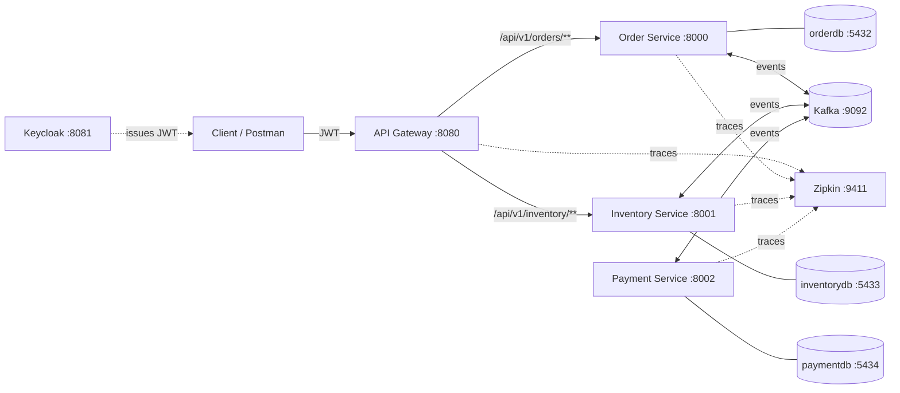
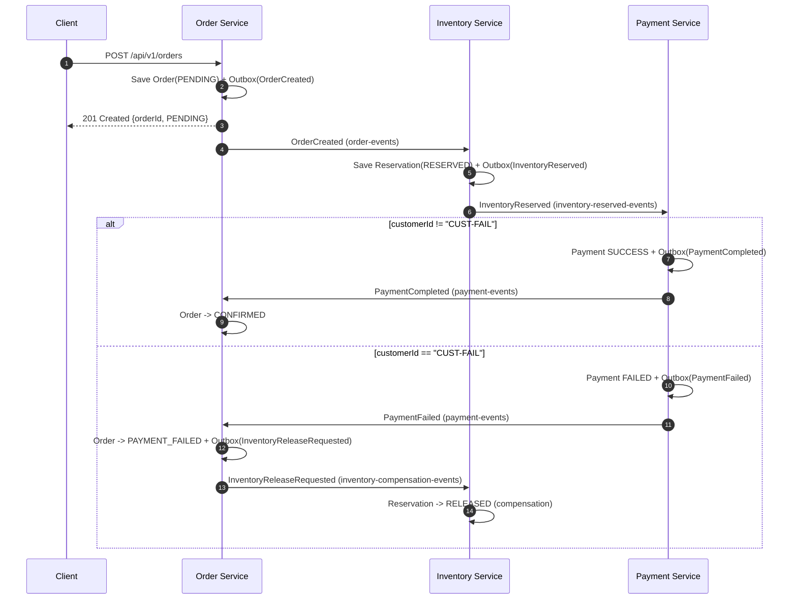

# Order Fulfillment Platform

This is a distributed order fulfillment platform made of Spring Boot microservices. It shows how to run a **choreography-based Saga** across services that each own their own database. The services talk through **Apache Kafka**, use the **Transactional Outbox** pattern to publish events reliably, and use **idempotent consumers** so duplicate events are handled safely. **Keycloak** (OAuth 2.0 / OIDC, JWT) secures the platform, and **OpenTelemetry + Zipkin** provide distributed tracing.

> Built as a Level-Up development project to cover microservice architecture, distributed transactions, Saga/compensation, security, persistence, and observability.

---

## Table of Contents

- [Architecture](#architecture)
- [Tech Stack](#tech-stack)
- [Modules](#modules)
- [Saga Workflow](#saga-workflow)
- [Kafka Topics & Events](#kafka-topics--events)
- [REST API](#rest-api)
- [Security](#security)
- [Observability](#observability)
- [Getting Started](#getting-started)
- [Testing](#testing)
- [Project Structure](#project-structure)
- [Documentation](#documentation)
- [Known Limitations / Roadmap](#known-limitations--roadmap)

---

## Architecture



Key design decisions:

| Concern | Approach |
|---|---|
| Service boundaries | Separate services, each with its own database ([ADR-001](docs/adr/ADR-001-microservice-boundaries.md)) |
| Communication | Hybrid: REST for client queries and commands, Kafka for business workflows ([ADR-002](docs/adr/ADR-002-communication-strategy.md)) |
| Entry point | Spring Cloud Gateway (Server MVC) with a circuit breaker ([ADR-003](docs/adr/ADR-003-api-gateway.md)) |
| Distributed transaction | Choreography Saga with compensating actions |
| Reliable messaging | Transactional Outbox, with a scheduled poller that runs every 5 s |
| At-least-once delivery | Idempotent consumers backed by a `processed_events` table |
| Security | Keycloak JWT validated at the gateway **and** at each service (defense in depth) |

---

## Tech Stack

| Category | Technology |
|---|---|
| Language | Java 21 |
| Framework | Spring Boot 4.1.1, Spring Cloud 2025.1.3 |
| Gateway | Spring Cloud Gateway Server WebMVC, Resilience4j Circuit Breaker |
| Persistence | Spring Data JPA / Hibernate, PostgreSQL 17 |
| Messaging | Apache Kafka 4.0 (KRaft mode, no ZooKeeper) |
| Security | Spring Security OAuth2 Resource Server, Keycloak 26.8 |
| Observability | Spring Boot Actuator, Micrometer Tracing, OpenTelemetry, Zipkin |
| Build | Maven (multi-module) |
| Infrastructure | Docker Compose |

---

## Modules

| Module | Port | Database | Responsibility |
|---|---|---|---|
| [`api-gateway`](api-gateway) | 8080 | — | Single external entry point. Handles routing, JWT validation, role-based authorization, and the `orderService` circuit breaker. |
| [`order-service`](order-service) | 8000 | `orderdb` (5432) | Exposes the order REST API, owns the order lifecycle, starts the Saga, and reacts to payment results. |
| [`inventory-service`](inventory-service) | 8001 | `inventorydb` (5433) | Reserves inventory for new orders and releases it during compensation. |
| [`payment-service`](payment-service) | 8002 | `paymentdb` (5434) | Processes payments for reserved orders and emits a success or failure event. |

### Persisted tables

| Service | Tables |
|---|---|
| order-service | `orders`, `outbox_events` |
| inventory-service | `inventory_reservations`, `outbox_events`, `processed_events` |
| payment-service | `payments` (unique on `order_id`), `outbox_events`, `processed_events` |

Hibernate creates and updates the schemas automatically (`ddl-auto=update`).

---

## Saga Workflow



- **Happy path:** `PENDING` → `CONFIRMED`
- **Failure path:** `PENDING` → `PAYMENT_FAILED`, then the inventory reservation is set to `RELEASED`
- To **simulate a payment failure**, create an order with `"customerId": "CUST-FAIL"`.

In every service, the business state change and its outbox record are written in the **same local DB transaction**. A `@Scheduled(fixedDelay = 5000)` publisher sends unpublished outbox rows to Kafka and then marks them as published.

---

## Kafka Topics & Events

All messages are JSON strings keyed by `orderId`. Each event includes `eventId` (UUID), `occurredAt`, and `version`.

| Topic | Event | Producer | Consumer | Payload fields |
|---|---|---|---|---|
| `order-events` | `OrderCreated` | order-service | inventory-service | `orderId`, `customerId` |
| `inventory-reserved-events` | `InventoryReserved` | inventory-service | payment-service | `orderId`, `customerId` |
| `payment-events` | `PaymentCompleted` | payment-service | order-service | `orderId`, `paymentId` |
| `payment-events` | `PaymentFailed` | payment-service | order-service | `orderId`, `paymentId`, `reason` |
| `inventory-compensation-events` | `InventoryReleaseRequested` | order-service | inventory-service | `orderId`, `reason` |

Consumer groups: `order-service`, `inventory-service`, `payment-service`.

---

## REST API

Base path (via gateway): `http://localhost:8080/api/v1/orders`

| Method | Path | Required role | Description |
|---|---|---|---|
| `POST` | `/api/v1/orders` | `ORDER_WRITE` | Create an order (starts the Saga) |
| `GET` | `/api/v1/orders/{orderId}` | `ORDER_READ` | Get order status |
| `GET` | `/api/v1/orders/health` | `ORDER_READ` | Simple liveness string |

**Create order**

```http
POST /api/v1/orders
Authorization: Bearer <access_token>
Content-Type: application/json

{ "customerId": "CUST-001" }
```

```json
201 Created
{ "orderId": "ORD-3f1c...", "status": "PENDING" }
```

**Error responses** have the following shape:

```json
{
  "timestamp": "2026-01-01T10:00:00Z",
  "status": 400,
  "message": "Validation failed",
  "path": "/api/v1/orders",
  "errors": [{ "field": "customerId", "message": "Customer ID must not be blank" }]
}
```

| Status | When |
|---|---|
| `400` | `customerId` is blank |
| `401` | Missing, invalid, or expired token |
| `403` | Token does not have the required role |
| `404` | Order not found |

Order statuses: `PENDING`, `INVENTORY_RESERVED`, `CONFIRMED`, `PAYMENT_FAILED`, `OUT_OF_STOCK`.

---

## Security

- **Identity Provider:** Keycloak at `http://localhost:8081`, realm `levelup-realm`
- **Issuer URI** (used by every service): `http://localhost:8081/realms/levelup-realm`
- **Realm roles:** `ORDER_WRITE`, `ORDER_READ`
- `KeycloakRoleConverter` maps the JWT `realm_access.roles` claim to Spring authorities (`ORDER_WRITE` → `ROLE_ORDER_WRITE`).
- The gateway **and** the order service both enforce the role rules, so calling port `8000` directly does not bypass authorization. The inventory and payment services require an authenticated JWT for all HTTP endpoints.
- All services are stateless (`SessionCreationPolicy.STATELESS`) and have CSRF disabled.

### Keycloak setup (one time)

1. Open `http://localhost:8081` and log in with `admin` / `admin` (dev only).
2. Create the realm `levelup-realm`.
3. Create the client `levelup-gateway` (OpenID Connect). Enable *Standard flow* (Authorization Code + PKCE) and add the Postman callback as a redirect URI.
4. Create the realm roles `ORDER_WRITE` and `ORDER_READ`.
5. Create the users, for example `levelup-user` with both roles and `levelup-reader` with `ORDER_READ` only.
6. In Postman, get a token with **Authorization Code (PKCE)** and call the gateway.

See [docs/architecture/security-artifact.md](docs/architecture/security-artifact.md) for the full write-up and verification matrix.

---

## Observability

- **Tracing:** Every service exports spans to Zipkin (`http://localhost:9411`) with a sampling probability of `1.0`. Kafka producer and listener observation is enabled, so a single trace covers HTTP → Kafka → downstream consumers.
- **Actuator:** `health`, `info`, and `metrics` are exposed on all services. The gateway also exposes `circuitbreakers`.
- **Circuit breaker** (`orderService`, on the gateway): count-based window of 5 calls, 50% failure threshold, 10 s open state, and 2 calls allowed in the half-open state.

---

## Getting Started

### Prerequisites

- JDK 21
- Maven 3.9+
- Docker and Docker Compose

### 1. Start the infrastructure

```bash
docker compose up -d
```

| Container | Image | Host port |
|---|---|---|
| `order-service-postgres` | postgres:17 | 5432 |
| `inventory-service-postgres` | postgres:17 | 5433 |
| `payment-service-postgres` | postgres:17 | 5434 |
| `order-service-kafka` | apache/kafka:4.0.0 | 9092 |
| `levelup-keycloak` | keycloak:26.8.0 | 8081 |
| `levelup-zipkin` | openzipkin/zipkin | 9411 |

Then complete the [Keycloak setup](#keycloak-setup-one-time).

### 2. Build

```bash
mvn clean install -DskipTests
```

### 3. Run the services (each one in its own terminal)

```bash
mvn -pl order-service spring-boot:run
mvn -pl inventory-service spring-boot:run
mvn -pl payment-service spring-boot:run
mvn -pl api-gateway spring-boot:run
```

### 4. Try it

```bash
TOKEN=<access token from Keycloak>

# Happy path
curl -X POST http://localhost:8080/api/v1/orders \
  -H "Authorization: Bearer $TOKEN" -H "Content-Type: application/json" \
  -d '{"customerId":"CUST-001"}'

# Compensation path
curl -X POST http://localhost:8080/api/v1/orders \
  -H "Authorization: Bearer $TOKEN" -H "Content-Type: application/json" \
  -d '{"customerId":"CUST-FAIL"}'

# Wait for the outbox pollers (~5-15 s), then check the status
curl http://localhost:8080/api/v1/orders/<orderId> -H "Authorization: Bearer $TOKEN"
```

Open Zipkin at `http://localhost:9411` to see the end-to-end trace.

> The default credentials in `docker-compose.yml` and `application.properties` are for **local development only**.

---

## Testing

```bash
mvn test                      # all modules
mvn -pl order-service test    # a single module
```

| Module | Tests |
|---|---|
| order-service | `OrderServiceTest` (unit: create, get, not-found), `OrderPersistenceIntegrationTest` (JPA round-trip), context load |
| inventory-service / payment-service / api-gateway | Context load tests |

> The `@SpringBootTest` tests need the Docker Compose infrastructure (PostgreSQL, Kafka, Keycloak) to be running. Surefire runs with `-Duser.timezone=Asia/Kolkata`.

---

## Project Structure

```
order-fulfillment-platform/
├── pom.xml                      # Parent POM (Spring Boot 4.1.1, Java 21)
├── docker-compose.yml           # Postgres x3, Kafka, Keycloak, Zipkin
├── api-gateway/                 # Spring Cloud Gateway (routes, security, circuit breaker)
├── order-service/
│   └── src/main/java/com/levelup/order/
│       ├── controller/          # OrderController
│       ├── service/             # OrderService (Saga start + payment handlers)
│       ├── domain/              # Order, OrderStatus
│       ├── dto/                 # Request/response records
│       ├── messaging/           # Event records, Kafka publishers & consumer
│       ├── outbox/              # OutboxEvent + scheduled OutboxPublisher
│       ├── repository/          # JPA repositories
│       ├── exception/           # GlobalExceptionHandler
│       └── config/              # SecurityConfig, KeycloakRoleConverter
├── inventory-service/
│   └── src/main/java/com/levelup/inventory/
│       ├── domain/              # InventoryReservation, ProcessedEvent
│       ├── messaging/           # OrderEventConsumer, InventoryCompensationConsumer
│       ├── publisher/           # InventoryOutboxPublisher, InventoryEventPublisher
│       └── ...
├── payment-service/
│   └── src/main/java/com/levelup/payment/
│       ├── service/             # PaymentService (success / CUST-FAIL failure)
│       ├── messaging/           # PaymentEventConsumer, PaymentEventPublisher
│       ├── outbox/              # PaymentOutboxPublisher
│       └── ...
└── docs/                        # ADRs, architecture, requirements
```

---

## Documentation

| Document | Description |
|---|---|
| [Functional requirements](docs/requirements/functional-requirements.md) | FR-01 and onward |
| [Non-functional requirements](docs/requirements/non-functional-requirements.md) | Security, resilience, and performance targets |
| [System context](docs/architecture/system-context.md) | High-level context diagram |
| [Service boundaries](docs/architecture/service-boundaries.md) | Responsibilities and ownership of each service |
| [Communication strategy](docs/architecture/communication-strategy.md) | REST vs Kafka |
| [Service discovery](docs/architecture/service-discovery.md) | Client-side vs server-side discovery |
| [Saga architecture](docs/architecture/sagaarchitecture.md) · [Saga implementation](docs/adr/saga-implementation.md) | Saga and compensation design |
| [Security artifact](docs/architecture/security-artifact.md) | Keycloak / JWT implementation and verification |
| [ADR-001](docs/adr/ADR-001-microservice-boundaries.md) · [ADR-002](docs/adr/ADR-002-communication-strategy.md) · [ADR-003](docs/adr/ADR-003-api-gateway.md) | Architecture decision records |
| [Order service walkthrough](order-service/architecture/architecture.md) | Code-level walkthrough |
| [API gateway architecture](api-gateway/architecture/api-gateway-architecture.md) | Gateway topology |
| [Payment workflow](payment-service/workflows/process-payment.md) | Payment decision flow |

---

## Known Limitations / Roadmap

- Inventory is simulated: every order is reserved, and there is no stock catalogue yet. `OUT_OF_STOCK` is defined but not used.
- Order Service does not consume `InventoryReserved`, so the `INVENTORY_RESERVED` status is not set yet.
- Payment is simulated: any `customerId` equal to `CUST-FAIL` is declined.
- The gateway has a route for `/api/v1/inventory/**`, but inventory-service has no REST controller yet. Payment service has no gateway route.
- Order Service tells `PaymentFailed` apart from `PaymentCompleted` by checking whether a `reason` field is present. An explicit event-type header would be more robust.
- Service URLs are static. Service discovery is documented but not implemented.
- There is no dead-letter topic or retry/back-off policy yet for consumers that fail.
- Testcontainers-based integration tests and containerized service images are not included yet.
